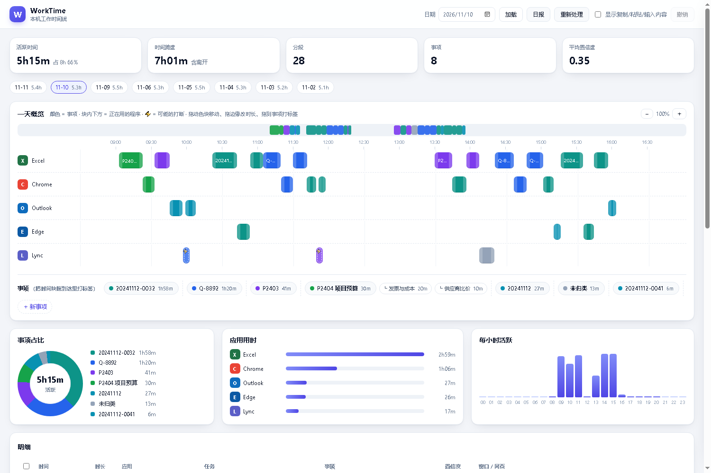
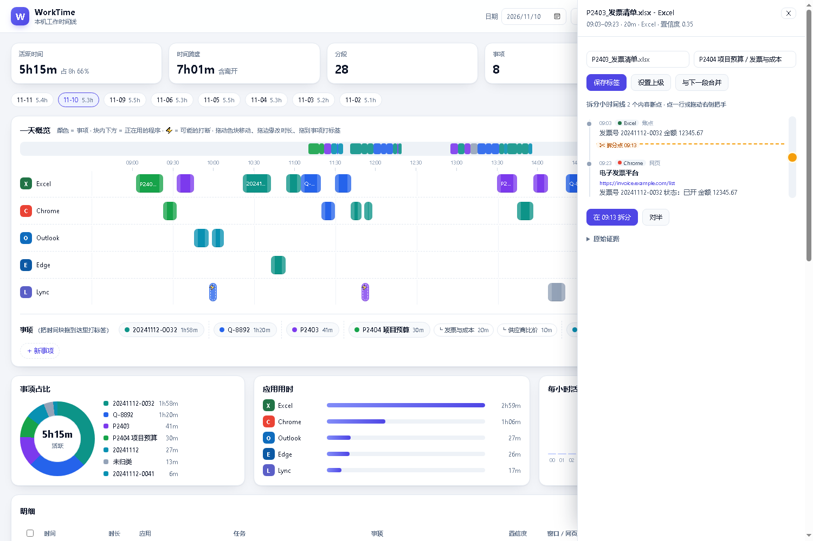

# WorkTime — local-first work timeline for Windows

[English](README.md) · [中文](README.zh-CN.md)

> Automatic, privacy-first time tracking that answers: **“what did I actually do today?”**
> No cloud, no telemetry, no screenshots, no keyboard hooks. Everything stays on your PC.

[](#requirements)
[](LICENSE)
[](#tests)
[](#privacy-by-design)



## What it does

WorkTime records which window, page and text field you are actually using, turns the day into a
single timeline, and lets you drag/label segments into projects and tasks — so an 8-hour day becomes
a reviewable list of “matter / task / time”.

- **Automatic timeline** — foreground app, window title, browser page (URL/title/visible text),
  focused UI text (Excel cells, Outlook mail, Lync chats), clipboard copy/paste events, idle/away.
- **One look, full picture** — per-app lanes, 24h overview bar, matter donut, app bars, hourly activity.
- **Drag to correct** — move blocks, resize edges, drag a block onto a matter to tag it.
- **Interruption detection** — a short Lync/Teams message between two same-app segments is flagged ⚡.
- **Split with context** — vertical mini-timeline shows every content breakpoint, with a draggable
  split handle; web/focus/clipboard content is embedded right in the timeline rows.
- **Hierarchical matters** — `Client / Project / Sub-task`, colors roll up to the top level.
- **Automatic rules** — “app/title/domain/focused-text → matter” with substring, exact and regex
  matching, priorities and hit counters. Rules run before clustering, so the same client lands in the
  same matter every day without dragging. See [docs/RULES.md](docs/RULES.md).
- **Billing (optional)** — per-matter hourly rates with parent inheritance, billable flag, configurable
  rounding, Markdown/CSV invoices and amount columns in period reports. See
  [docs/BILLING.md](docs/BILLING.md).
- **Live collector status** — a status pill in the review UI (running / paused / offline), pause/resume
  without leaving the browser, today’s timeline auto-refreshes, plus a Windows tray icon
  (`start-tray.bat`).
- **Opt-in multi-device sync** — export a bundle to a folder you control (OneDrive, NAS, USB), with a
  manual switch per data class: times, matter names, window titles, URLs, page text, focused text,
  clipboard. Off by default; imported days stay in a separate table. See [docs/SYNC.md](docs/SYNC.md).
- **Optional local LLM** — cluster segments and name them with a local Qwen GGUF via llama.cpp
  (CPU only, no GPU required). Deterministic naming works without any model.
- **Permission presets** — `strict` / `metadata` / `standard` / `full` / `enterprise` capture scopes,
  per-channel switches (titles, URLs, page text, focused text, clipboard, idle), excluded apps/domains,
  configurable retention, and an IT-lockable policy (`policy.locked`). The extension can drop page
  text/selection independently of the URL.
- **Daily / weekly / monthly / yearly reports** — switch periods in the review UI; KPI cards, matter donut, app bars and per-day/per-month activity charts above the detail tables; export Markdown + CSV; raw content is excluded from exports.



## Privacy by design

| Principle | Implementation |
|---|---|
| Local only | SQLite under the app folder; HTTP binds `127.0.0.1` only |
| No telemetry | no analytics, no auto-update, no remote API |
| No screenshots | defaults to text-only capture; no screen recording |
| No keyboard logging | reads the focused control’s text, never raw keystrokes |
| Minimal clipboard | stores hash + first 240 chars, never full text; password managers excluded; high-entropy content (cards, ids, tokens) stores only hash + length |
| Passwords never read | focused-text capture skips `IsPassword` controls and excluded apps |
| Sync is opt-in | off by default, one switch per data class, bundle written to a folder you choose; imported data lives in a separate `foreign_days` table |
| You own deletion | retention (30 days raw / 7 days clipboard) + one-click uninstall |

WorkTime is **not** an employee-monitoring product. If used at work, get IT approval and follow
your company’s data policy. See [`docs/privacy.md`](docs/privacy.md) and
[`docs/IT-审批材料.md`](docs/IT-审批材料.md) (Chinese approval template).

## Requirements

- Windows 10/11 x64
- No administrator rights, no GPU, no Python required (portable runtime is bundled)
- Chrome or Edge for page context (optional but recommended)
- Optional packages (`requirements.txt`): `uiautomation` + `comtypes` for focused-text capture,
  `openpyxl` for XLSX export. `setup-user.bat` installs them when `pip` is available.

## Quick start

1. Download `WorkTime-v0.2.0.zip` from [Releases](releases/latest) and extract it to
   `%LOCALAPPDATA%\WorkTime\`.
2. Run `setup-user.bat` — creates `config.json` + token, installs optional packages, adds a
   minimized Startup shortcut.
3. Load the extension: `chrome://extensions` / `edge://extensions` → Developer mode →
   *Load unpacked* → select the `extension` folder, then paste the token into the extension options.
4. Run `run-collector.bat` (or just sign in next time). `start-tray.bat` adds a tray icon with the
   live status and a pause switch.
5. End of day: `process-today.bat`; open the review UI with `review.bat`
   (or the **WorkTime UI** desktop shortcut).
6. Optional: build rules in 设置 → 自动规则, set rates in 设置 → 计费, wire a sync folder in
   设置 → 多端同步.

> The ZIP is unsigned. Verify the SHA-256 shown in the release notes before running.

## Build from source (developers)

```bat
python -m unittest discover -s tests -p "test_*.py" -v
python -m wt.cli simulate --date 2026-11-06 --days 5
python -m wt.cli process --date 2026-11-06 --days 5
python -m wt.cli review
```

Build the portable ZIP:

```powershell
powershell -ExecutionPolicy Bypass -File scripts\package-portable.ps1 `
  -PythonDir "C:\Path\To\Python312" -OutDir "dist\WorkTime" -Zip
```

## Tests

```bat
run-tests.bat
```

64 unit/end-to-end tests: segmentation rules, clipboard glue, aliasing, clustering, auto-rules,
reports, billing/invoices, sync channel filtering + encryption + import idempotency, privacy
heuristics and capture-policy presets.

## Status & roadmap

v0.2.0 turns the prototype into something you can run weekly: rules remove the repetitive dragging,
sync is opt-in per data class, billing closes the “hours → invoice” loop, and the collector is
visible (status pill + tray). Known limitations:

- Excel window titles stop at workbook level (sheets inside one file are indistinguishable).
- Outlook preview pane doesn’t change the window title; open mails in separate windows for best results.
- Enterprise policies may block unpacked browser extensions; use the `enterprise` preset there.
- UI is Chinese-first; English localization is planned.
- No code signing yet (SmartScreen warning is expected).
- Sync is folder-based (manual push/pull); no automatic background sync or conflict resolution beyond
  per-device-per-day replacement.

Roadmap: English UI, signed builds, better auto-naming, automatic background sync, Firefox extension,
optional LAN-only aggregation.

## 中文简介

WorkTime 是一个 Windows 本机工作时间线工具：自动记录窗口、网页、焦点文本和复制粘贴，
切成时间线后可拖动、打标签、拆分、查看内容，支持“父级 / 子级”事项和本地 CPU 模型命名。
v0.2.0 新增：自动归类规则、按通道手动开关的多端同步（默认关闭）、事项费率与工时单、
采集器实时状态与托盘暂停。数据只存在本机、无任何联网、无截图、无键盘钩子；免管理员权限即可运行。

## Contributing

Issues and PRs are welcome — please read [`CONTRIBUTING.md`](CONTRIBUTING.md) and keep the
**local-first / no-telemetry** constraint. For security reports use [`SECURITY.md`](SECURITY.md).

## Beta & sharing

Want to ask a group chat or community for feedback? Copy-paste posts for AI groups, Discord,
V2EX, Reddit and Show HN are in [`docs/SHARE.md`](docs/SHARE.md); the beta test plan and feedback
questions are in [`docs/BETA.md`](docs/BETA.md). Use the simulated-data screenshots in
`docs/screenshots/` and never post real window titles or clipboard content.

## 中文简介

WorkTime 是一个 Windows 本机工作时间线工具：自动记录窗口、网页、焦点文本和复制粘贴，
切成时间线后可拖动、打标签、拆分、查看内容，支持“父级 / 子级”事项和本地 CPU 模型命名。
数据只存在本机、无任何联网、无截图、无键盘钩子；免管理员权限即可运行。
当前 v0.1.0 为原型版本，欢迎试用并反馈。

## License

MIT — see [`LICENSE`](LICENSE).
