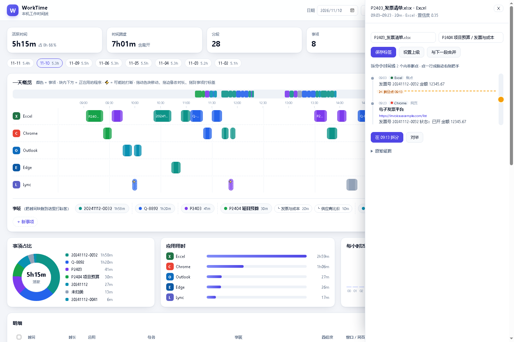

# WorkTime · 本机工作时间线（中文说明）

> 一个 Windows 上**完全本地**的工作时间统计工具：自动记录前台窗口、浏览器页面、
> 焦点输入框和复制粘贴，把一天切成时间线；可以拖动、打标签、拆分、查看内容；
> 支持日报 / 周报 / 月报 / 年报、自动归类规则、事项计费，以及**按通道手动开关**的多端同步。
> **无云端、无遥测、无截图、无键盘钩子**，免管理员权限即可运行。


## 功能

- **自动时间线**：应用、窗口标题、浏览器 URL/标题/可见文字、Excel 单元格与邮件正文焦点文本、
  复制粘贴、空闲/离开；浏览器部分由 Chrome/Edge 扩展补充。
- **可视化复核**：按应用分层的时间线、24 小时概览、事项环形图、应用用时、每小时活跃；
  色块可拖动移动、拉边缘改时长、拖到「事项」上打标签；支持多选批量、撤销、拆分/合并。
- **打断识别**：短时间插入在两段同一程序之间（邮件 → Lync 消息 → 回邮件）会标 ⚡。
- **内容抽屉**：网页正文、焦点输入、复制粘贴按需显示；默认打码，导出不含原文。
- **层级事项**：`客户 / 项目 / 子任务`，色块按父级配色，图表按父级汇总。
- **自动规则**：`应用 / 标题 / 域名 / 焦点文本 → 事项`，支持包含、`=` 精确、`re:` 正则与优先级；
  命中后每次重新处理都会自动归类，人工标签仍然优先。见 [docs/RULES.md](docs/RULES.md)。
- **报告**：日报 / 周报 / 月报 / 年报，含 KPI、环形图、应用条形图、按天/按月活跃图，
  可下载 Markdown；设置费率后自动多出工时与金额两列。
- **计费（可选）**：事项单价按 `客户 / 项目` 层级继承，支持是否计费、按时长取整，
  输出 Markdown + CSV 工时单。见 [docs/BILLING.md](docs/BILLING.md)。
- **采集器实时状态**：复核页右上角显示「采集中 / 已暂停 / 未运行」，可一键暂停/恢复；
  今天的界面会自动刷新；`start-tray.bat` 提供同样的托盘开关。
- **多端同步（默认关闭）**：同步包写到你自己选的文件夹（OneDrive / 坚果云 / NAS / U 盘），
  **每个数据类单独开关**（时间、事项名、窗口标题、URL、网页正文、焦点文本、剪贴板），
  导入的数据单独放一张表，不混进本机时间线；可选口令加密。见 [docs/SYNC.md](docs/SYNC.md)。
- **权限预设**：严格 / 仅元数据 / 标准 / 完整 / 企业受限；窗口标题、URL、网页正文、焦点输入、
  剪贴板、空闲逐项开关；可排除程序与域名、设置保留期；IT 可用 `policy.locked` 锁定。
- **可选本地 LLM**：llama.cpp + Qwen GGUF（CPU 即可）给聚类结果命名；不装也能用。



## 隐私设计

| 原则 | 实现 |
|---|---|
| 只在本机 | SQLite 存在程序目录，HTTP 只绑定 `127.0.0.1` |
| 无遥测/自动更新 | 不访问外网，不收集使用数据 |
| 无截图/无键盘钩子 | 只读焦点控件文本，不记录原始按键；密码框（IsPassword）直接跳过 |
| 剪贴板最小化 | 只存哈希 + 前 N 字符；密码管理器黑名单；高熵内容（卡号/身份证/令牌）只存哈希与长度 |
| 同步可关闭 | 默认关闭，逐通道选择；加密包写在用户指定的文件夹，不经过服务器 |
| 可删除 | 保留期可配，卸载脚本一键删除 |

本工具定位是**个人效率工具**，不是员工监控软件；公司使用请走 IT 审批与知情同意。
企业环境建议直接用 `enterprise` 预设（只记窗口标题与时长，不装扩展、不读输入框、不碰剪贴板）。

## 快速开始

1. 从 Releases 下载 `WorkTime-v0.2.0.zip`，解压到 `%LOCALAPPDATA%\WorkTime\`；
2. 运行 `setup-user.bat`（生成 token、安装可选依赖、创建启动快捷方式）；
3. Chrome/Edge 加载 `extension` 目录，并填入 token；
4. `run-collector.bat` 开始采集；`start-tray.bat` 加托盘（可选）；
5. 下班 `process-today.bat`，`review.bat` 打开界面；
6. 可选：`设置 → 自动规则` 建规则、`设置 → 计费` 填单价、`设置 → 多端同步` 接同步文件夹。

> 未签名，SmartScreen 会提示；请核对 Release 里的 SHA-256，或从源码构建。

## 常用命令

```bat
wt rules add --name "所有 Excel 对账" --app excel --matter "客户A / 对账"
wt rules test --date 2026-11-12
wt matter set --path "客户A" --rate 800
wt invoice --date 2026-11-30 --period month
wt sync preview --days 7
wt live
```

## 从源码运行

```bat
python -m pip install -r requirements.txt
python -m unittest discover -s tests -p "test_*.py" -v
python -m wt.cli simulate --date 2026-11-06 --days 5
python -m wt.cli process --date 2026-11-06 --days 5
python -m wt.cli review
```

## 参与

- 反馈/内测：GitHub Discussions（Q&A / Ideas / Show your setup）；
- 想发群/社区：`docs/SHARE.md` 有可直接复制的文案；
- 请保持 **local-first / 无遥测** 的约束；安全报告见 `SECURITY.md`。

## 许可

MIT，见 [LICENSE](LICENSE)。
